# Ниже представлены 10 практических заданий по BIOS/UEFI

Все задания можно выполнить в Lenovo BIOS Simulator Center (https://download.lenovo.com/bsco/index.html), выбрав модель ThinkPad или ThinkCentre.

## Задача 1. Включение аппаратной виртуализации (Intel VT-x / AMD-V)

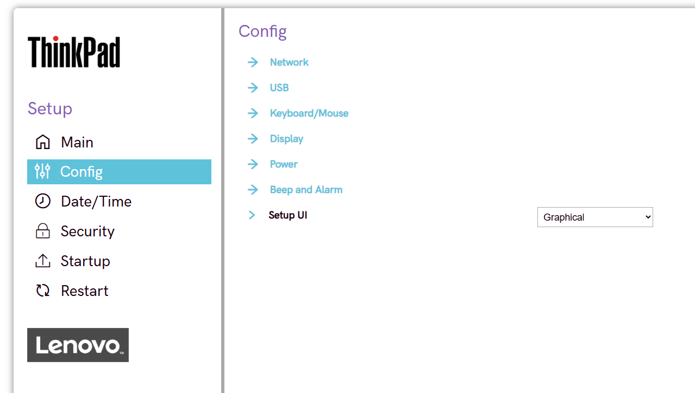

## Задача 2. Проверка статуса TPM и его связь с BitLocker

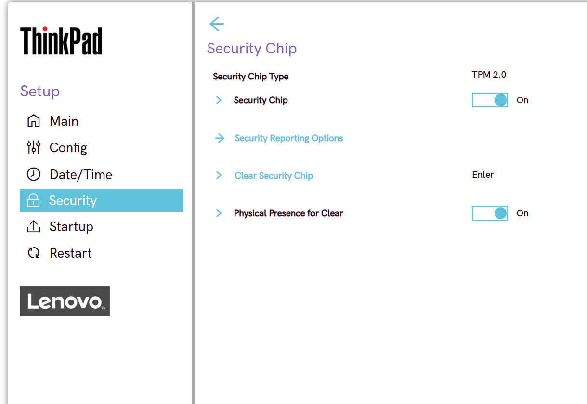

## Задача 3. Настройка поведения при потере питания (After Power Loss)

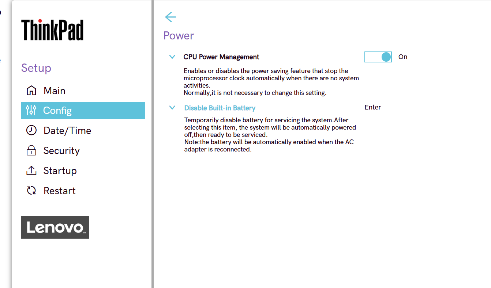

**Перезагрузка: При изменении этого параметра в интерфейсе UEFI (на данном экране) нет предупреждения о необходимости перезагрузки**

## Задача 4. Отключение Secure Boot и проверка последствий

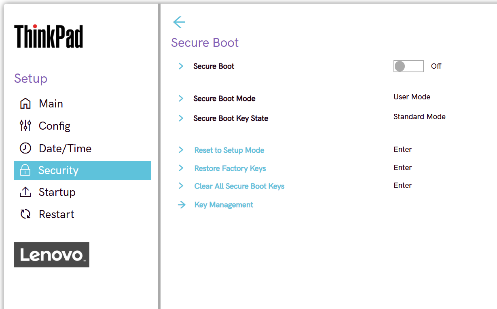

## Задача 5. Настройка порядка загрузки через Fast Boot

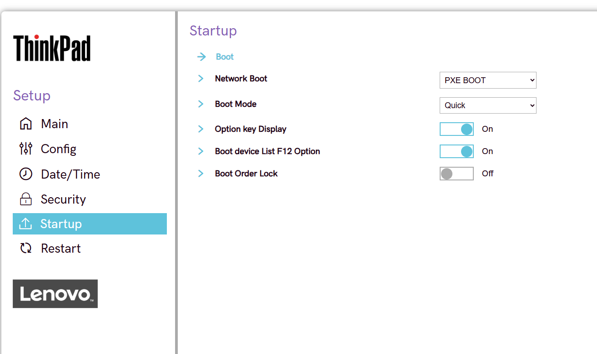

## Задача 6. Установка пароля на включение (Power-On Password)

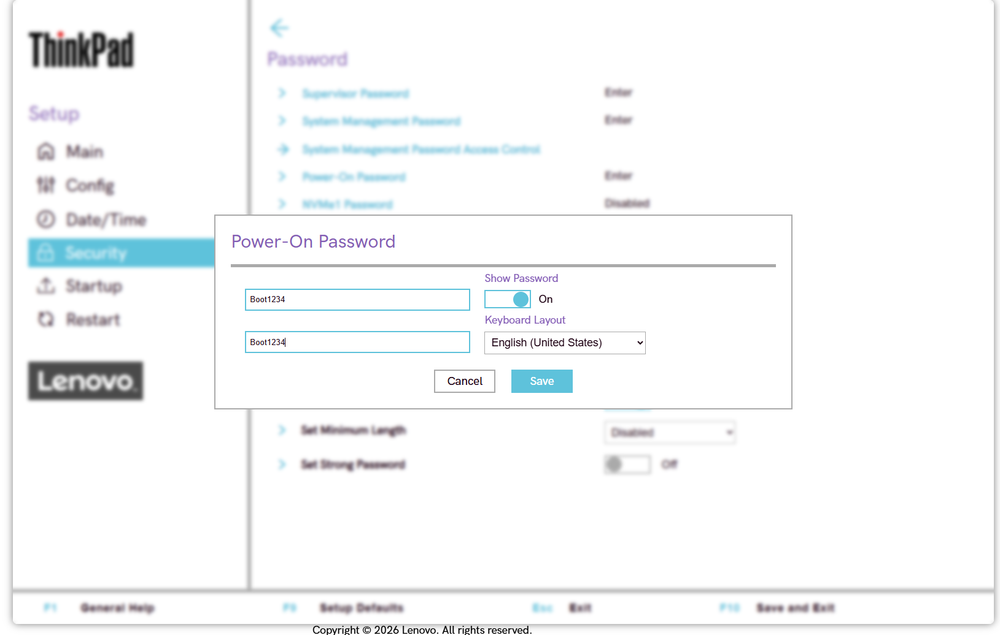

## Задача 7. Настройка SATA Controller Mode для установки ОС

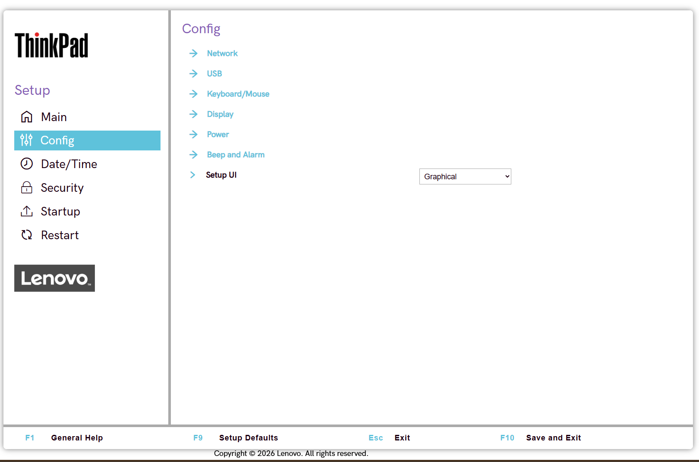

## Задача 8. Просмотр и очистка системного журнала событий (Event Log)

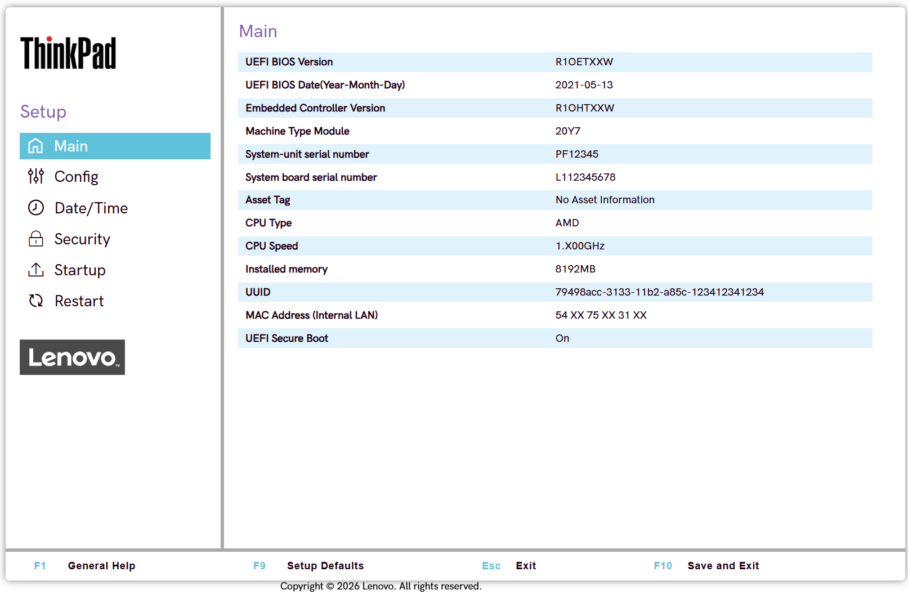

## Задача 9. Восстановление заводских настроек с сохранением пользовательских данных

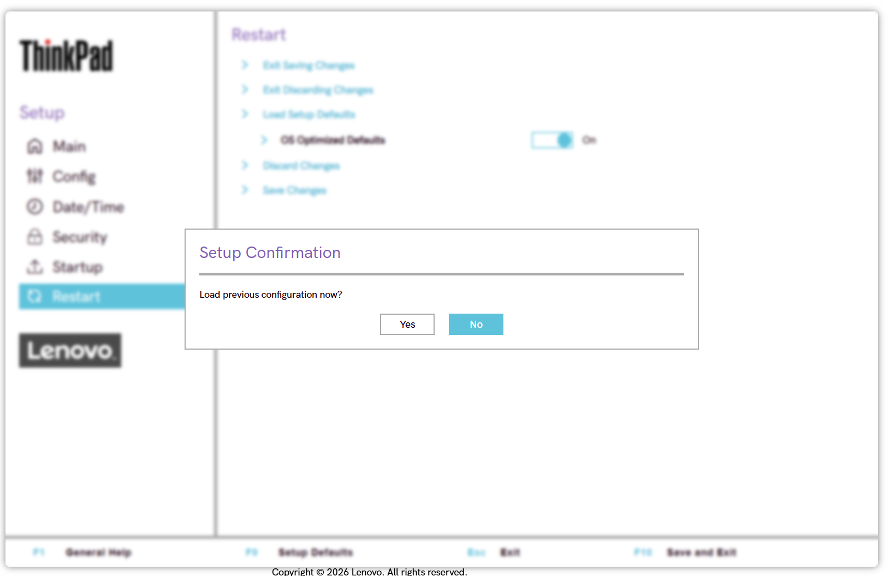

## Задача 10. Полный сценарий: подготовка нового сотрудника (IT-администратор

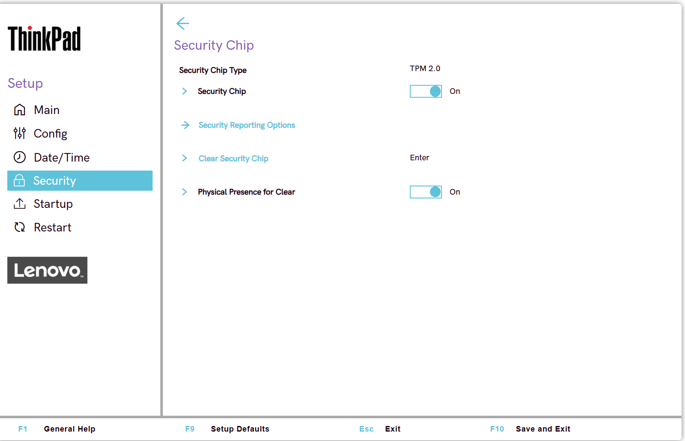
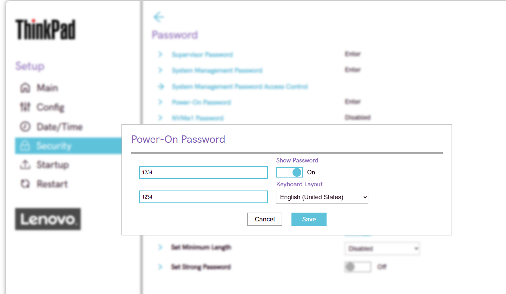
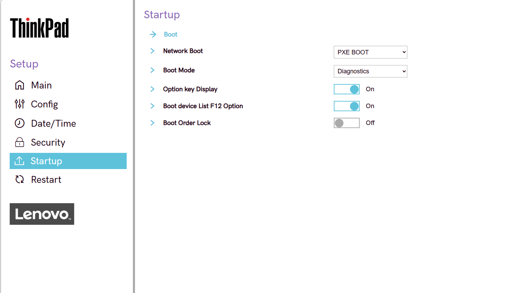

**Снова войти, проверить настройки, сбросить пароль и вернуть порядок загрузки**

