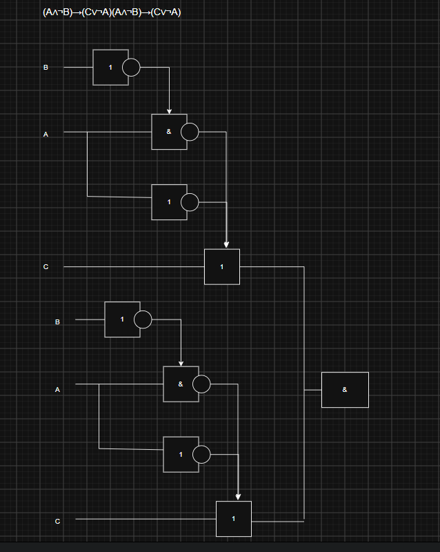
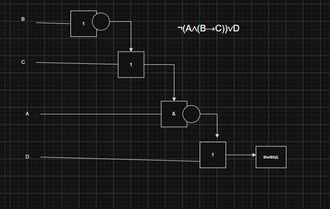

### Имя: Геращенко Ксения
### Группа: РПО2-9\3

# Задание 1:
  
## Схема 1:

(¬A ∧ B) ∨ (A ∧ ¬B)

## Схема 2:

((¬0 ∨ 1) ∧ (0 ∧ ¬1)) ∨ (¬0 ∨ 0)

# Задание 2:

## Пример 1:

(A∧¬B)→(C∨¬A)(A∧¬B)→(C∨¬A)

## Пример 2:

¬(A∧(B→C))∨D

