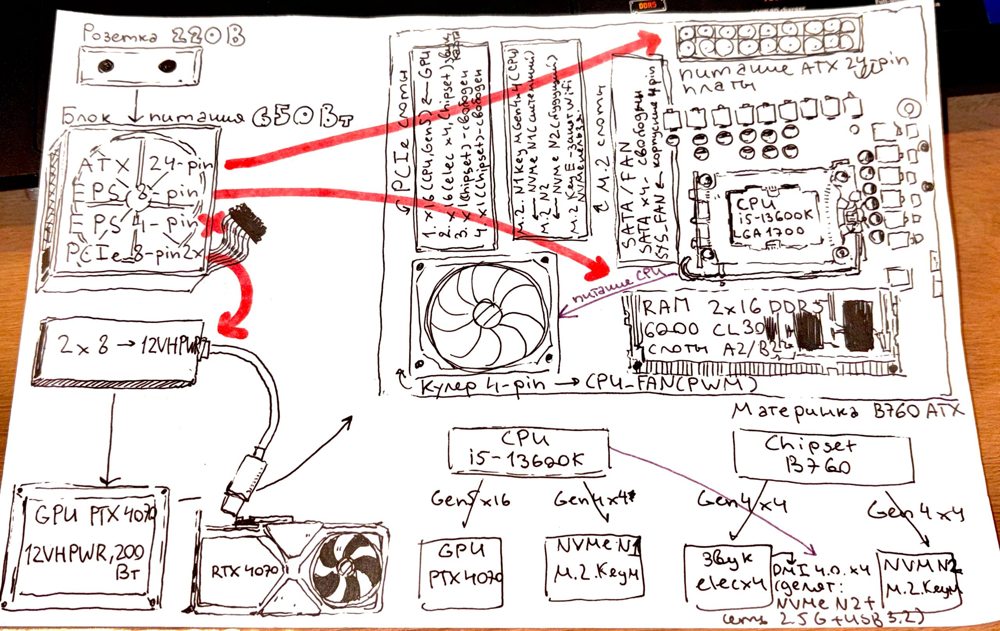

# Комплексная задача: «Сборка и диагностика ПК без BIOS и доп. программ»

## Условие задачи

Вы — системный интегратор. К вам обратился клиент со следующим запросом:

> «Нужен ПК для игр в 1440p и стриминга. Бюджет — ограничен, но хочу стабильность. У меня уже есть корпус **Mid-Tower с поддержкой ATX/mATX/Mini-ITX**, блок питания **650 Вт с одним EPS 8-pin и одним ATX 24-pin**, и кулер **с 4-pin PWM**. Всё остальное — на вас. И ещё: я хочу потом сам добавить второй NVMe SSD и, возможно, звуковую карту. Соберите так, чтобы ничего не пришлось менять».

Вам выдали **три варианта комплектующих** (выбирать нужно один набор):

| Компонент | Вариант A | Вариант B | Вариант C |
|---|---|---|---|
| **CPU** | Intel Core i5-13600K (LGA1700, 125 Вт базовый / 181 Вт turbo) | AMD Ryzen 7 7700X (AM5, 105 Вт TDP / 142 Вт PPT) | Intel Core i5-12400F (LGA1700, 65 Вт) |
| **Материнская плата** | ATX, B760, 4×DDR5 DIMM, 2×M.2 (оба Key M, Gen4×4), PCIe x16 (CPU, Gen5) + PCIe x16 (electrical x4, chipset) + 2×PCIe x1, 4×SATA, VRM 12+1 фаз | mATX, B650, 4×DDR5 DIMM, 1×M.2 (Key M, Gen4×4) + 1×M.2 (Key E, Wi-Fi), PCIe x16 (CPU, Gen4) + PCIe x1 (chipset), 4×SATA, VRM 8+2 фаз | ATX, H610, 2×DDR4 DIMM, 1×M.2 (Key M, Gen3×4), PCIe x16 (CPU, Gen4) + PCIe x1, 4×SATA, VRM 6+1 фаз |
| **RAM** | 2×16 ГБ DDR5-6000 CL30 (EXPO/XMP) | 2×16 ГБ DDR5-6000 CL30 (EXPO/XMP) | 2×8 ГБ DDR4-3200 CL16 |
| **GPU** | RTX 4070 (PCIe 4.0 x16, 200 Вт, 12VHPWR) | RTX 4070 (PCIe 4.0 x16, 200 Вт, 12VHPWR) | RTX 4060 (PCIe 4.0 x8, 115 Вт, 8-pin) |
| **SSD** | 1× NVMe Gen4×4 1 ТБ (M.2 Key M) | 1× NVMe Gen4×4 1 ТБ (M.2 Key M) | 1× SATA SSD 1 ТБ |
| **Охлаждение CPU** | Башня 4-pin PWM, TDP до 180 Вт | Башня 4-pin PWM, TDP до 180 Вт | Боксовый кулер 4-pin PWM, TDP до 65 Вт |

---

## Задания (выполняются только на бумаге / в уме, без запуска ПК и без входа в BIOS)

### Задание 1. Выбор набора и обоснование (темы: форм-факторы, совместимость, чипсеты, VRM)

1.1. Какой из трёх наборов **не подходит** клиенту по форм-фактору корпуса? Объясните почему, указав размеры платы и корпуса.

**Набор B (mATX, B650).** Плата mATX имеет размеры **244×244 мм** (или 244×226 мм), и формально mATX **влезает** в Mid-Tower с поддержкой ATX/mATX/Mini-ITX — корпус клиента прямо заявлен как поддерживающий mATX. Поэтому по форм-фактору **все три набора совместимы** с корпусом
**Ответ:** формально ни один набор не отсеивается по форм-фактору; mATX (B) совместим с Mid-Tower, поддерживающим mATX

1.2. Какой набор **не позволяет** выполнить требование «добавить второй NVMe SSD и звуковую карту»? Укажите конкретный разъём, которого не хватает, и почему переходник не решает проблему.

**Набор C (H610).** У платы:
- **всего 1× M.2 Key M** (Gen3×4) — второго слота M.2 для NVMe **нет**;
- слотов PCIe: **1× PCIe x16 (CPU) + 1× PCIe x1** — звуковую карту поставить можно в x1, но второй NVMe — некуда

Переходник **M.2 → PCIe** не решает проблему, потому что:
- свободный слот только **PCIe x1**, а NVMe требует минимум **x4** линий;
- переходник PCIe - M.2 в x1 даст скорость ~1 ГБ/с (Gen3×1), что бессмысленно для NVMe;
- переходник SATA - M.2 не даёт NVMe-протокола

**Ответ: набор C** — не хватает второго слота M.2 Key M и нет свободного PCIe x4 для переходника

1.3. Какой набор **не подходит** по блоку питания? Посчитайте ориентировочное энергопотребление (CPU turbo + GPU + 50 Вт на остальное) и сравните с 650 Вт, а также проверьте наличие нужных разъёмов питания.

**Ответ:** По мощности все проходят (A: 431 Вт, B: 392 Вт, C: 230 Вт). Но A проблемный: плата EPS 8+4, БП даёт только 1× EPS 8-pin. GPU 12VHPWR (A, B) требует переходника, которого нет в описании БП

1.4. Из оставшихся наборов выберите лучший для игр в 1440p и стриминга. Обоснуйте выбор с точки зрения:
- числа фаз VRM и TDP процессора;
- поддержки XMP/EXPO чипсетом;
- запаса по линиям PCIe для будущих устройств.

**Ответ:** Набор A — VRM 12+1 (лучший), 2× M.2, XMP, запас PCIe. B хорош, но только 1× M.2 Key M

### Задание 2. Анализ линий PCIe и ограниченной совместимости (темы: линии CPU vs Chipset, физическая vs электрическая совместимость)

2.1. В выбранном наборе укажите, какие линии PCIe идут **напрямую от CPU**, а какие — **от чипсета**. Заполните таблицу:

| Устройство | Слот | Источник линий | Версия PCIe | Число линий |
|---|---|---|---|---|
| GPU | PCIe x16 (верхний) | **CPU** | Gen5 (GPU работает Gen4) | x16 |
| NVMe SSD №1 | M.2 Key M №1 | **CPU** (обычно верхний M.2) | Gen4 | x4 |
| Звуковая карта | PCIe x16 (electrical x4) | **Chipset** | Gen4/Gen3 | x4 (электрически) |
| NVMe SSD №2 | M.2 Key M №2 | **Chipset** | Gen4 | x4 |

2.2. Клиент хочет поставить звуковую карту в слот **PCIe x16 (electrical x4)**. Физически она влезет? Электрически будет работать? На какой скорости? Объясните правило «больше — можно, меньше — нельзя».

**Ответ:** Влезет, заработает, Gen4×1. Правило: больше линий — можно, меньше — нельзя

2.3. Если клиент установит второй NVMe SSD в слот M.2, который подключён к чипсету, а одновременно будет активно работать сеть 2.5G и USB 3.2 — какое ограничение возникнет? Назовите канал, через который чипсет общается с CPU, и объясните, почему возможен «бутылочный горлышко».

**Ответ:** Канал чипсета — DMI 4.0 ×4 (~8 ГБ/с). NVMe №2 + 2.5G + USB 3.2 вместе упираются в DMI - бутылочник. Системный NVMe ставить в CPU-слот

2.4. Можно ли в выбранной плате использовать NVMe SSD в слоте **Key E** (который обычно занят Wi-Fi-модулем)? Ответ обоснуйте с точки зрения ключей M.2 и назначения слотов.

**Ответ:** Нельзя: Key E не равен Key M (физически), и там максимум x1 — NVMe не заработает. Key E — для Wi-Fi

---

### Задание 3. Питание и VRM (темы: PS_ON#, PWR_OK, VRM, EPS, ATX 24-pin)

3.1. Опишите по шагам, что произойдёт с питанием платы после нажатия кнопки Power, если блок питания исправен, но **сигнал PWR_OK не поднимается** (неисправность БП). До какого этапа дойдёт система и почему?

**Ответ:** БП включается, но PWR_OK не поднимается → Reset с CPU не снимается → POST не начинается, изображения нет. Система «питание есть, старта нет»

3.2. В выбранном наборе VRM имеет 12+1 фаз. Объясните, зачем нужно такое количество фаз для процессора с TDP 125 Вт / turbo 181 Вт. Что произойдёт, если поставить этот CPU на плату с VRM 6+1 фаз (как в варианте C)?

**Ответ:** 12+1 делит ток (181 Вт ≈ 140–150 А) по фазам → меньше нагрев, стабильнее. На 6+1 — перегрев VRM, троттлинг, просадки
  
3.3. Блок питания имеет **один EPS 8-pin**. Материнская плата выбранного набора имеет разъёмы **EPS 8-pin + EPS 4-pin**. Можно ли подключить только 8-pin? К каким последствиям это приведёт при турбо-режиме CPU? Обоснуйте с точки зрения мощности и нагрева.

**Ответ:** Только 8-pin — можно, но 4-pin питает доп. фазы → турбо ограничен, 8-pin греется сильнее

3.4. Объясните разницу между **ATX 24-pin** и **EPS 8-pin** по назначению и напряжениям. Почему нельзя запитать CPU от 24-pin напрямую?

**Ответ:** ATX 24-pin: +3,3/+5/+12 В, PS_ON#, PWR_OK, дежурка. EPS 8-pin: только +12 В для CPU/VRM (4 линии +12 В). 24-pin не тянет ток CPU (2 линии +12 В, тонкие контакты)

---

### Задание 4. Память и профили (темы: DIMM, XMP/EXPO, тренировка DDR, чипсеты)

4.1. В выбранном наборе RAM — DDR5-6000 CL30 с профилем EXPO/XMP. Объясните, что произойдёт при первом включении, если профиль **не активирован** вручную. На какой частоте и с какими таймингами заработает память? Почему?

**Ответ:** 

4.2. Клиент хочет добавить ещё 2 модуля RAM (итого 4×16 ГБ). Какие ограничения возникнут:
- по количеству слотов DIMM;
- по поддержке частоты (почему 4 модуля часто работают медленнее, чем 2);
- по контроллеру памяти CPU (IMC).

**Ответ:** Без EXPO — JEDEC 4800 МТ/с (CL40), т.к. профиль overclock не активен по умолчанию

4.3. Можно ли в выбранную плату (DDR5) установить модуль DDR4 из старого ПК? Объясните с точки зрения ключа DIMM и электрической несовместимости.

**Ответ:** 4 модуля = 2DPC - частота падает (6000 → 5200–5600 или JEDEC), нагрузка на IMC, хуже сигнал

4.4. Опишите, что делает UEFI при «тренировке DDR» и почему при неудаче EXPO система может откатиться на JEDEC-стандарт. Какая частота будет у DDR5 по JEDEC?

**Ответ:** Нельзя: ключ DIMM разный, DDR5 1,1 В vs DDR4 1,2 В, другая архитектура (PMIC, 2×32-бит канала)

---

### Задание 5. Smart-настройки без входа в BIOS (темы: Smart Fan, Zero RPM, PBO, Curve Optimizer, Adaptive Voltage, BIOS Flashback)

*Все ответы — на основе логики работы технологий, без реального запуска.*

5.1. Клиент жалуется, что в простое ПК шумный. Какие **две** smart-технологии из изученных нужно задействовать, чтобы устранить шум, не снижая производительность под нагрузкой? Опишите, как каждая из них работает и какие пороги/кривые вы бы предложили.

**Ответ:** Smart Fan (кривая: до 50 °C — 30–40%, 80 °C — 100%) + Zero RPM (стоп до 45–50 °C). В простое тишина, под нагрузкой раскрутка

5.2. Для выбранного набора (AMD или Intel — зависит от вашего выбора в задании 1) опишите, как **PBO + Curve Optimizer** (для AMD) или **Adaptive Voltage + Undervolting** (для Intel) повлияют на температуру и частоты. Приведите ожидаемый эффект в градусах и мегагерцах (ориентировочно).

**Ответ:** Intel: Adaptive Voltage + undervolt (−0,05…−0,1 В) - −5…−10 °C, +100…200 МГц в длительной нагрузке

5.3. Клиент купил новый процессор, который **не поддерживается текущей версией BIOS** платы. Плата не стартует. Опишите, как с помощью **BIOS Flashback** прошить плату без CPU и без входа в BIOS. Какие файлы и действия нужны?

**Ответ:** USB FAT32 + переименованный файл BIOS → спец. порт Flashback - только 24-pin + EPS - кнопка - мигание - готово (без CPU/RAM)

5.4. Объясните, почему **Zero RPM** не конфликтует с **Smart Fan**: как плата решает, когда полностью остановить вентилятор, а когда начать раскручивать. Что произойдёт, если порог Zero RPM поставить выше критической температуры VRM?

**Ответ:** Zero RPM — порог 0 об/мин, выше — работает кривая Smart Fan. Если порог выше крит. температуры VRM → перегрев VRM. Порог держать ниже

---

### Задание 6. Диагностика по симптомам (темы: все разделы)

Определите наиболее вероятную причину и предложите решение **без запуска ПК и без BIOS** (только по спецификациям и логике):

| № | Симптом | Диагноз | Решение |
|---|---|---|---|
| 6.1 | Плата mATX не влезает в корпус | Корпус не поддерживает mATX (только ATX/ITX) или мешают стойки/вырезы; либо путаница — mATX меньше ATX | Проверить спецификацию корпуса (поддержка mATX); при несовместимости — выбрать ATX-плату или другой корпус |
| 6.2 | GPU во втором слоте, просадки FPS | Второй слот — **electrical x4** (от чипсета), GPU теряет линии → пропускная способность x4 вместо x16, просадки | Переставить GPU в **верхний слот x16 (CPU, Gen5)** |
| 6.3 | 4 модуля RAM не стартуют на EXPO | 4 модуля = 2DPC, IMC не тянет 6000 → нестабильность | Отключить EXPO, работать на JEDEC (4800) или вручную снизить частоту до 5200–5600, поднять напряжение IMC/VDDQ |
| 6.4 | 181 Вт CPU на VRM 6+1 — троттлинг | VRM не рассчитан на ток, фазы перегреваются | Сменить плату на VRM 12+1 (набор A) или ограничить Power Limit / поставить обдув VRM |
| 6.5 | Ryzen 9000 не стартует на старой B650 | **BIOS не поддерживает новый CPU** (нужно обновление AGESA) | **BIOS Flashback** (или Flash BIOS Button) — прошить свежий BIOS без CPU |
| 6.6 | Вентилятор CPU на 100% постоянно | Неправильная кривая Smart Fan / режим DC вместо PWM / датчик или порог | Настроить Smart Fan (PWM, кривая), проверить подключение в CPU_FAN (4-pin) |
| 6.7 | Звуковая карта x1 не определяется в x16 (electrical x4) | Слот электрически x4, но карта x1 должна работать; причина — слот отключён/делит линии с M.2, или BIOS не назначает | Проверить, не делит ли слот линии с SATA/M.2; включить слот в BIOS; попробовать другой PCIe x1 |

---

### Задание 7. Итоговая схема сборки (темы: все разделы)

Нарисуйте (от руки или текстом) **схему подключения** выбранного набора, указав:

- какой разъём питания куда идёт (ATX 24-pin, EPS 8-pin, 12VHPWR для GPU);
- в какой слот PCIe ставится GPU и почему именно туда;
- в какой M.2 ставится NVMe №1 и куда пойдёт NVMe №2;
- куда подключаются вентиляторы (CPU_FAN, SYS_FAN) и почему 4-pin;
- где будет звуковая карта и почему выбранный слот;
- какие линии (CPU или Chipset) используются каждым устройством.
- 

Подпишите на схеме **все ограничения**, которые вы выявили в заданиях 1–6 (например: «второй M.2 делит канал с SATA», «EPS 4-pin не подключён — турбо ограничен» и т.д.).

1. EPS 4-pin ─ не подключён -> турбо CPU ограничен
2. 12VHPWR ─ нет кабеля -> нужен переходник 2x8
3. NVMe N2 ─ делит DMI -> бутылочник с сетью/USB
4. 4 модуля RAM 2DPC -> EXPO может откатиться на 4800
5. Key E ─ не Key M -> NVMe в Wi-Fi-слот нельзя
6. Zero RPM ─ порог < VRM -> иначе перегрев VRM
7. GPU ─ только слот 1 -> иначе просадки FPS
---

## Критерии оценки (для самопроверки)

| Задание | Что проверяется | Баллы |
|---|---|---|
| 1 | Форм-факторы, совместимость корпуса/БП, выбор чипсета и VRM | 15 |
| 2 | Линии CPU vs Chipset, физическая vs электрическая совместимость, ключи M.2 | 15 |
| 3 | PS_ON#/PWR_OK, VRM, EPS/ATX, последствия нехватки питания | 15 |
| 4 | XMP/EXPO, тренировка DDR, ограничения 4 модулей, DDR4 vs DDR5 | 15 |
| 5 | Smart Fan, Zero RPM, PBO/Curve Optimizer, Adaptive Voltage, BIOS Flashback | 15 |
| 6 | Диагностика по симптомам | 15 |
| 7 | Полная схема сборки с ограничениями | 10 |
| **Итого** | | **100** |
# Ответы на комплексную задачу «Сборка и диагностика ПК без BIOS и доп. программ»

---

---

Если нужно — могу оформить это как готовый `.md`-файл (скопировать блок ниже) или переструктурировать под конкретный шаблон сдачи.
