# 10 задач для отработки BIOS/UEFI в Lenovo BIOS Simulator Center
Симулятор: https://download.lenovo.com/bsco/index.html

**Выберите устройство ThinkPad (например, T14s Gen 5 или X1 Carbon Gen 12) в графическом режиме. Ниже — тайминг и критерии выполнения для каждой задачи.**

## Задача 1. Навигация по основным разделам

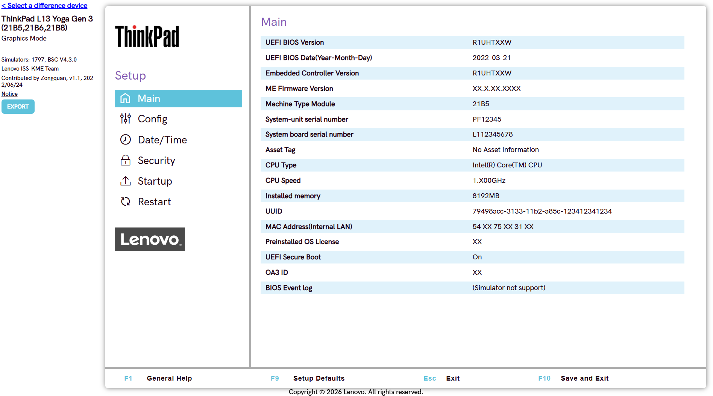

### Информация, отображаемая в разделе Main:

- Версия UEFI (UEFI BIOS Version): R1UHTXXW

- Тип CPU (CPU Type): Intel(R) Core(TM) CPU

- Серийный номер (System-unit serial number): PF12345

## Задача 2. Смена порядка загрузки

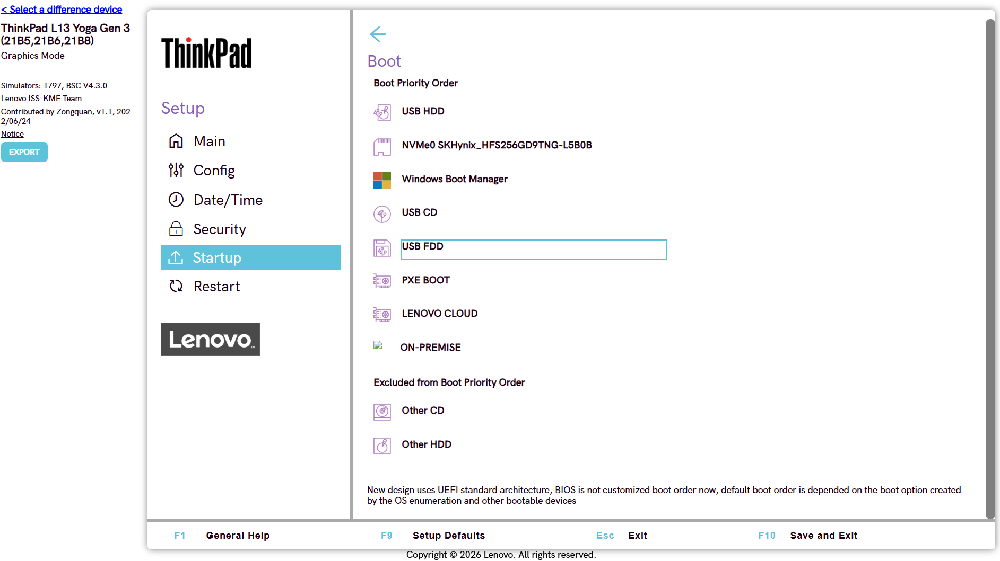

## Задача 3. Включение/выключение Secure Boot

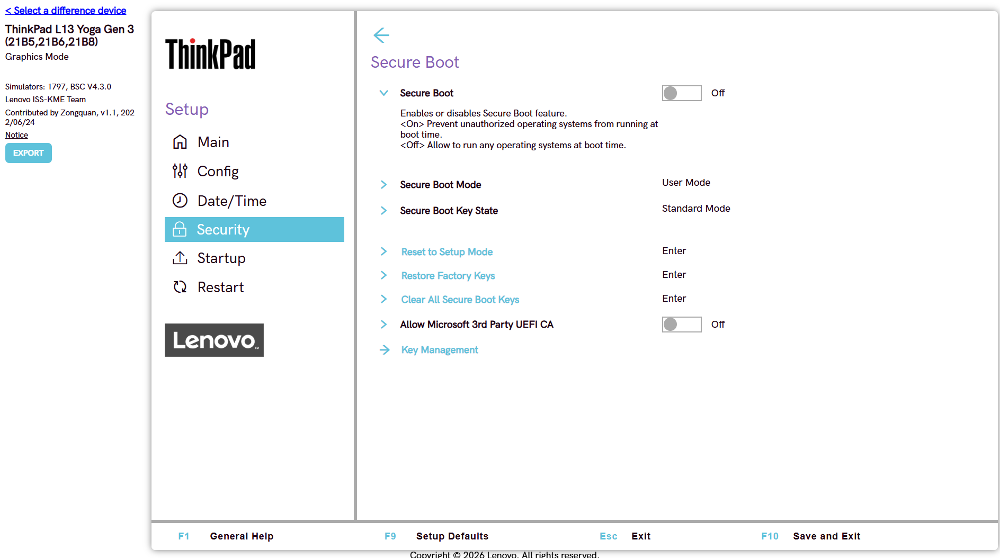

**Перезагрузка: При изменении этого параметра в интерфейсе UEFI (на данном экране) нет предупреждения о необходимости перезагрузки**

## Задача 4. Установка пароля супервизора

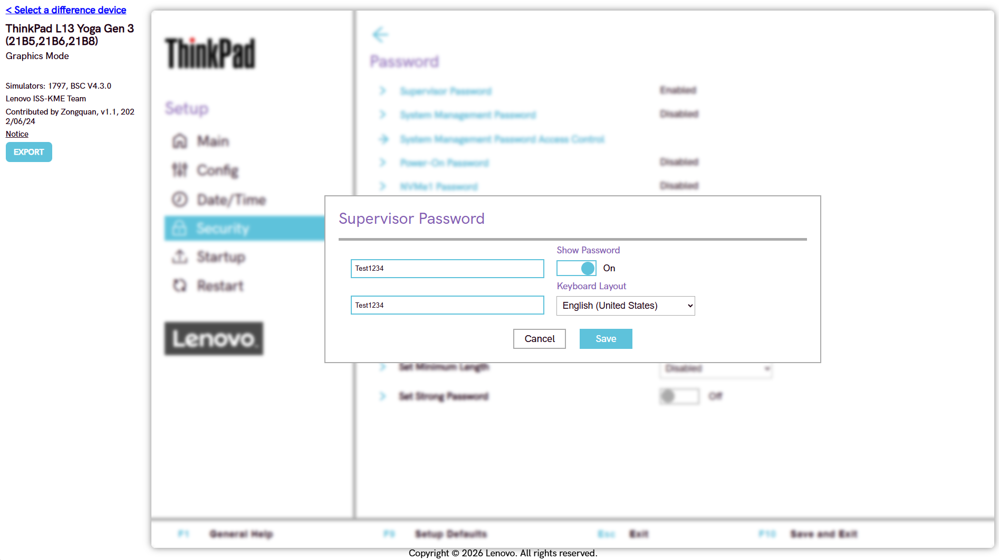

## Задача 5. Сброс на заводские настройки

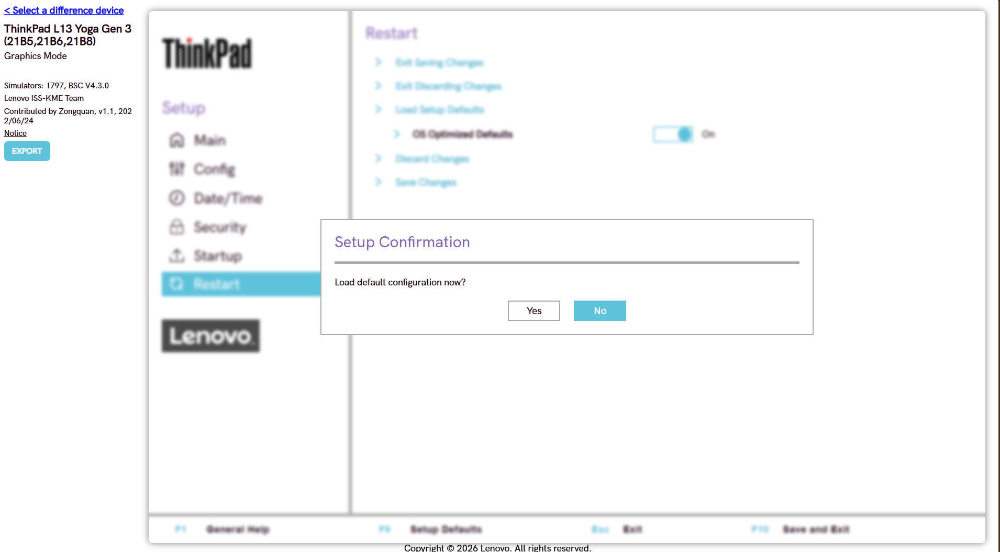

**Да, настройки из задач 2–4 сброшены**

## Задача 6. Управление встроенными устройствами

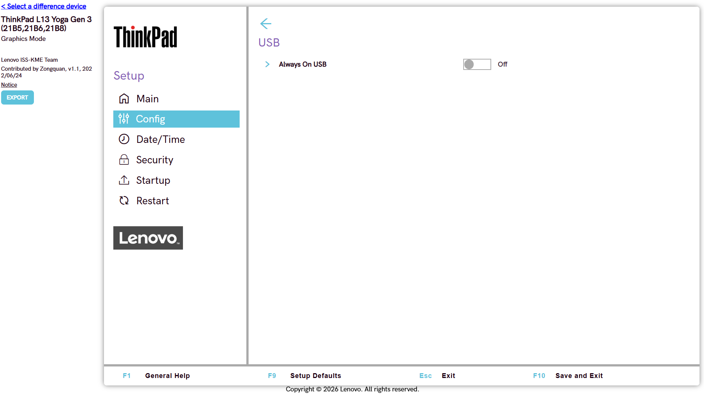

**Отключила, затем включила обратно**

## Задача 7. Режим работы SATA/NVMe

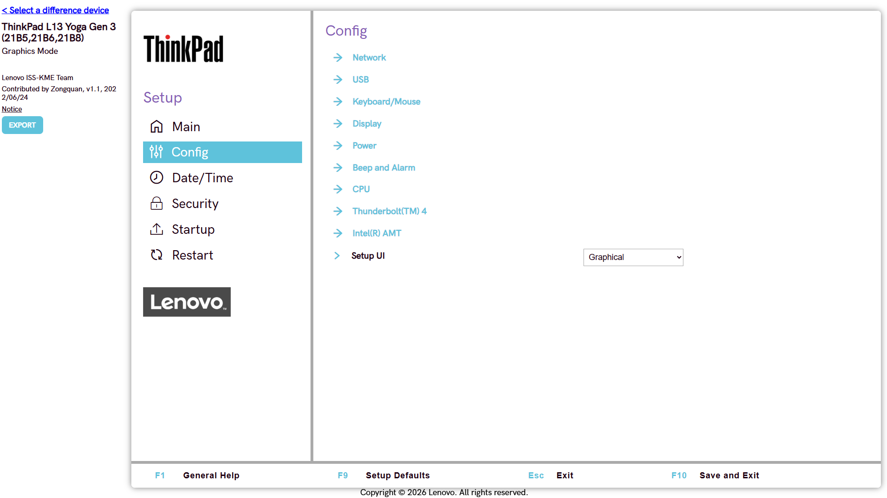

**Нету хранилища и SATA тк проводов SATA нету ....**

## Задача 8. Временное меню загрузки (эмуляция F12)

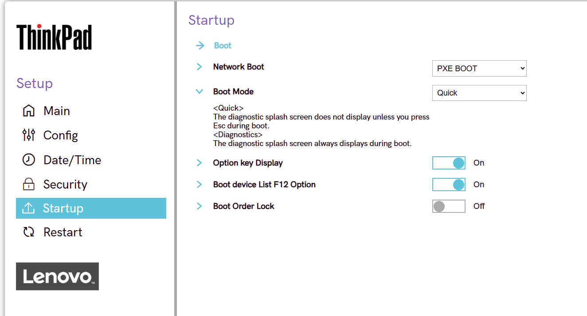

**Там ничего нигде не поменялось даже в главном меню, я нажимала сохранить ..**

## Задача 9. Просмотр системных логов

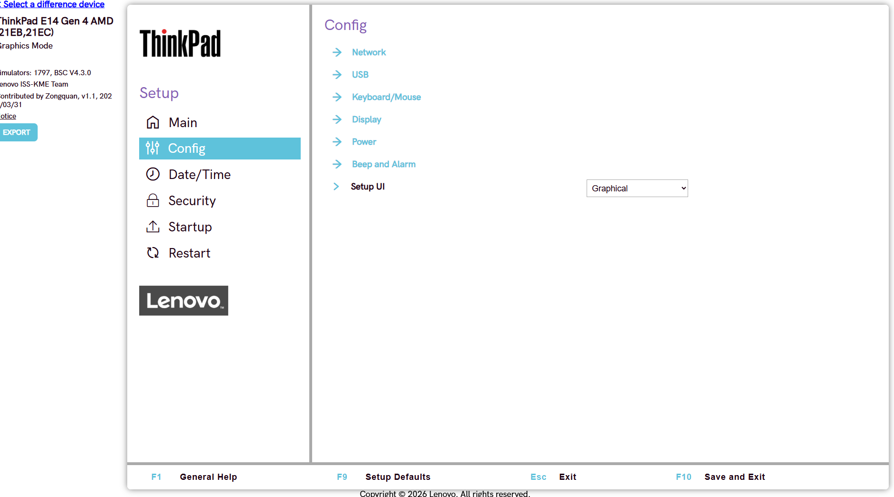
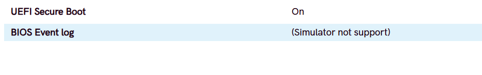

## Задача 10. Полный сценарий: подготовка к переустановке ОС

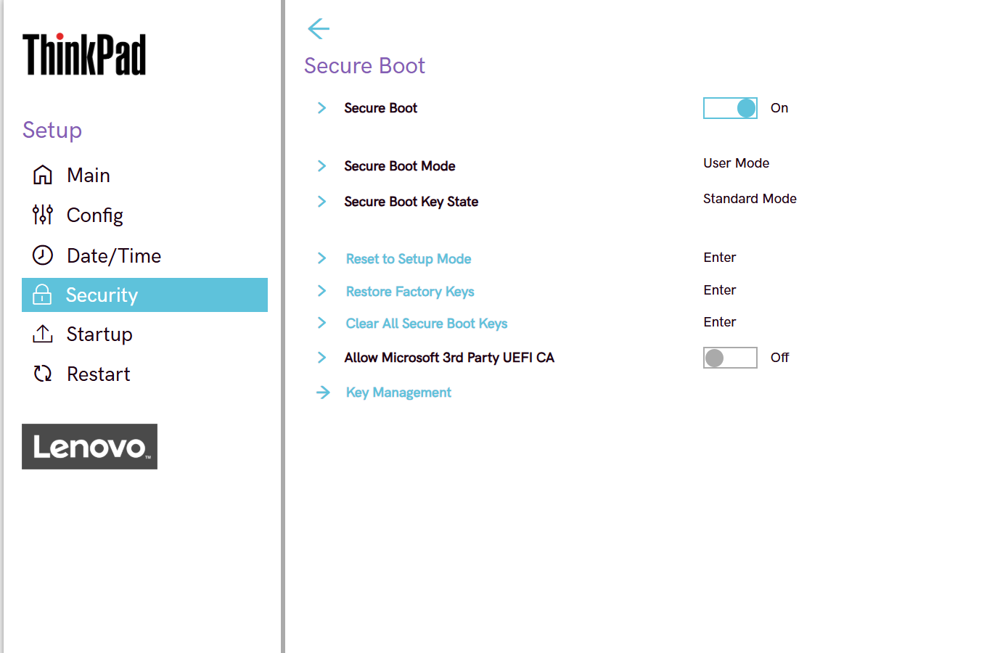
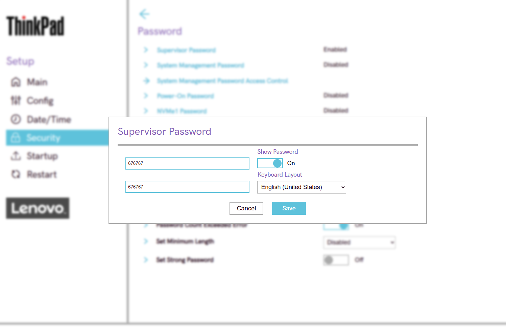
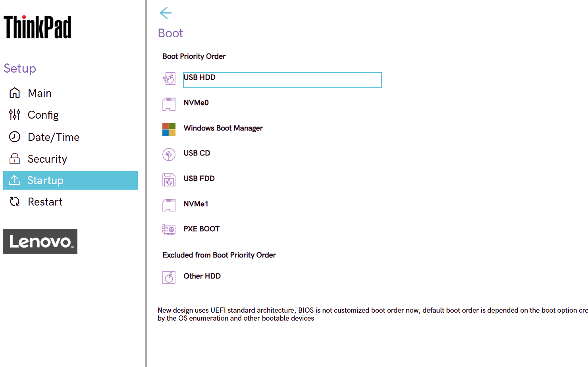

**Снова войти, проверить настройки, сбросить пароль и вернуть порядок загрузки**

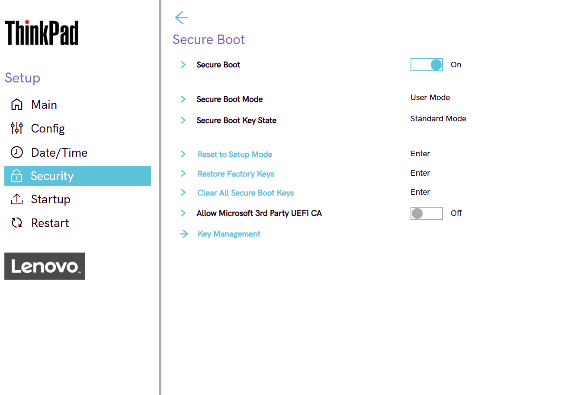
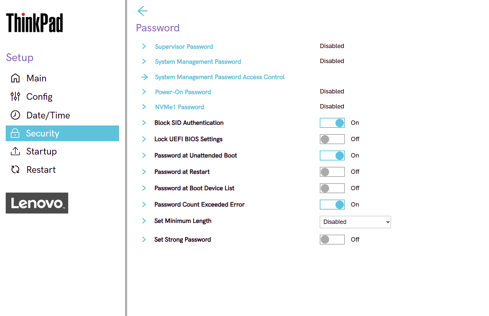
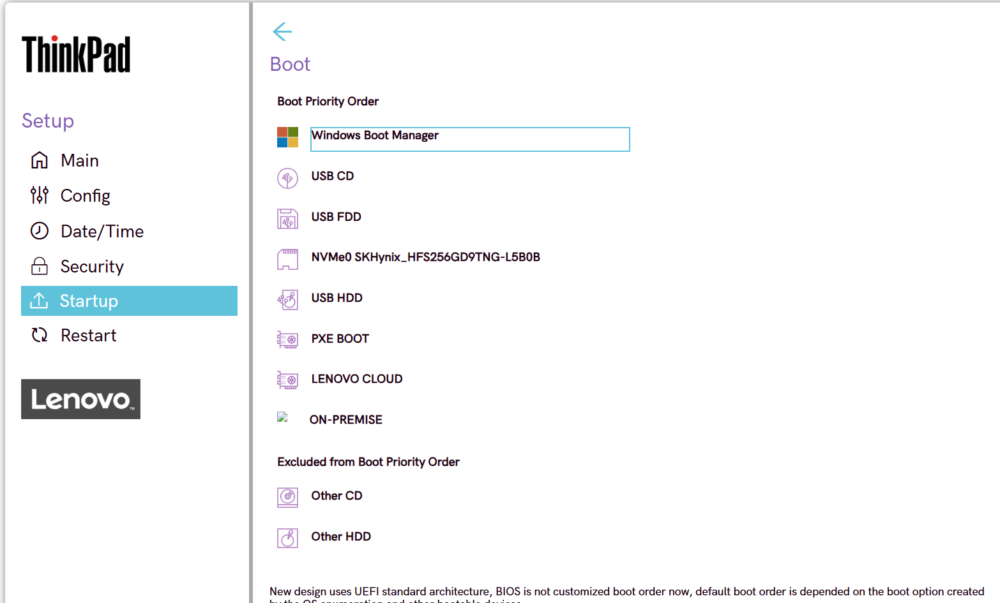
